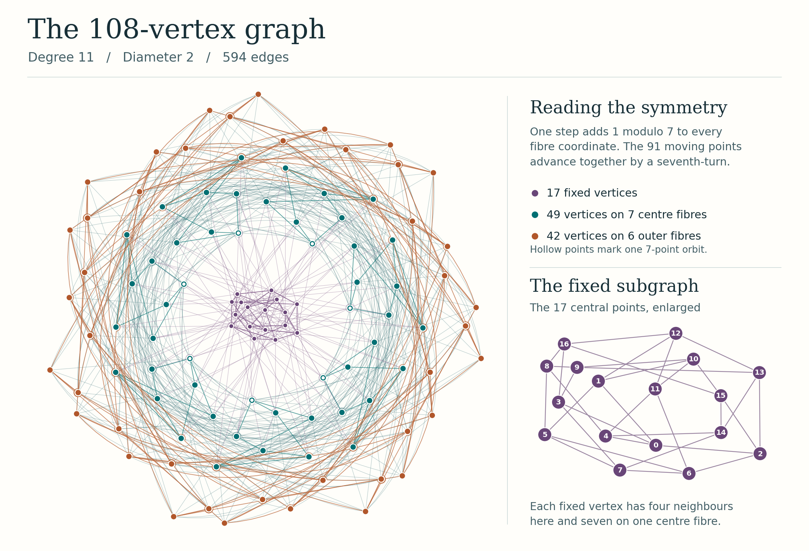
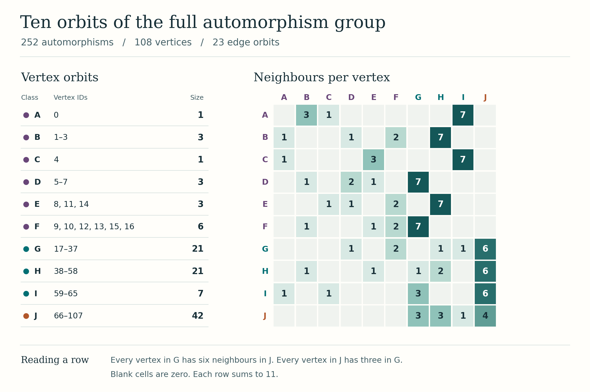

# Degree 11, diameter 2: 108 vertices

A simple **11-regular** graph on **108 vertices** with **594 edges** and diameter **exactly 2**. This construction gives $N(11,2)\ge108$. On 2026-11-26 the published table listed 106 vertices for this cell. The Moore bound is 122. [Comellas’s table](https://web.mat.upc.edu/francesc.comellas/delta-d/table_degree_diameter.html) · [Dated comparison](../../verification/table-cell-2026-11-26-degree11-diameter2.json)



One clock step takes coordinate $x$ to $x+1$ in each of the thirteen fibres. The 91 moving vertices and the 441 edges between them turn through $360^\circ/7$. The 17 purple vertices retain their individual positions. The seven hollow markers trace one centre fibre. The left drawing contains every edge exactly once. The inset repeats just the 34 edges between fixed vertices. [Vector drawing (SVG)](figures/n112_108_symmetry.svg) · [Print PDF](figures/n112_108_symmetry.pdf)

## Construction

Start with a 4-regular graph on vertices 0–16. Add seven centre fibres $C_0,\ldots,C_6$ and three pairs of outer fibres $(A_r,B_r)$ for $r=0,1,2$. Each fibre has one vertex for each coordinate in $\mathbb F_7$. The vertex ID of coordinate $x$ in fibre $i$ is $17+7i+x$. The centres have indices 0–6, and $A_r,B_r$ have indices $7+2r,8+2r$.

In the table below, join each fixed vertex in row $i$ to all seven vertices of $C_i$. Join each listed pair of centres at equal coordinates. The last two columns specify the connections to the outer fibres.

| Centre $i$ | Attached fixed vertices | Adjacent centres $j>i$ | $a_i$ | $b_i$ |
|---:|---|---|---:|---:|
| 0 | 5, 13, 15 | 5, 6 | 0 | 1 |
| 1 | 6, 9, 16 | 3, 6 | 3 | 5 |
| 2 | 7, 10, 12 | 4, 6 | 2 | 6 |
| 3 | 1, 14 | 4, 5 | 1 | 0 |
| 4 | 2, 8 | 5 | 5 | 3 |
| 5 | 3, 11 | — | 6 | 2 |
| 6 | 0, 4 | — | 4 | 4 |

For each scale $s_r=1,2,4$, join $C_i(x)$ to $A_r(x+s_ra_i)$ and $B_r(x+s_rb_i)$. Within the same outer pair, join $A_r(x)$ to $B_r(x+d)$ for $d\in\{0,3,5,6\}$. All shifts are modulo 7. The 34 edges of the fixed subgraph appear in the inset and in the constant `FIXED_FORWARD`. [Constructor](certificate/construct.py) · [Degree and diameter proof](certificate/proof.md)

## Full symmetry group

The full automorphism group has order **252** and is isomorphic to $C_6\times\operatorname{AGL}(1,7)$, identified by GAP as `SmallGroup(252,28)`. The translation above and a multiplier acting by $x\mapsto-2x$ on the centres generate the affine factor of order 42. A commuting symmetry of order 6 generates the other direct factor. Only vertices **0 and 4** are fixed by the entire group. The 17 vertices in the inset are fixed by the translation.



There are **10 vertex orbits** and **23 undirected edge orbits**. For example, orbit G consists of the 21 vertices on the first three centre fibres. Each has six neighbours in the 42-vertex outer orbit J. Conversely, each vertex in J has three neighbours in G. Both counts give the same 126 edges. The four J-neighbours per vertex account for 84 internal edges in J, which split into edge orbits of sizes 21 and 63. [Orbit chart (SVG)](figures/n112_108_orbits.svg) · [PDF](figures/n112_108_orbits.pdf) · [All orbit representatives, sizes and generators](certificate/orbits.json)

## Reproduction and data

From the repository root, run the following with Python 3.10+, Bash and a C++17 compiler.

```bash
bash results/degree11-diameter2/certificate/check.sh
```

This regenerates the published graph byte for byte, compares the full distance matrices from the Python and C++ implementations, and checks the permutations, both orbit partitions and the common-neighbour counts. Every vertex sees 11 vertices at distance 1 and 96 at distance 2. The complete matrix in vertex-ID order, using one byte per distance, has SHA-256 `f80141905f806813920070e8cec64f5fffe83ca80fd3c27ad2ff5e203210214d`.

- [Edge list](certificate/graph.edges) with header `108 594` and one undirected edge per row. [Adjacency list](certificate/graph.adjlist) with each vertex followed by its eleven neighbours.
- [Independent repository verifier report](../../verification/final/degree11-diameter2.json). [Ordinary queue BFS](certificate/verify_queue.cpp) and [bitset BFS](certificate/verify_layers.py) from the source package.
- [Original construction archive](certificate/archive/ddp-11-2-108.zip), including the discovery code and logs. The published edge list adds the repository header to the original edge rows and retains the original vertex numbering. [Package checksums](SHA256SUMS).
- [Drawing code](figures/draw.py) for both plates. Run `python3 results/degree11-diameter2/figures/draw.py` with Matplotlib 3.7+ and NumPy. The [drawing checks](figures/drawing-check.json) record the SVG edge and vertex counts and the geometric rotation test.

To recompute the **full group** from the uncoloured edge list, build the repository’s nauty utility and check its output against the saved orbit data. The command assumes that the nauty headers and library are on the compiler search path. For Homebrew, add `-I"$(brew --prefix)/include" -L"$(brew --prefix)/lib"` to the compile command.

```bash
c++ -O2 -std=c++17 verification/automorphisms.cpp -lnauty -o /tmp/ddp108-aut
/tmp/ddp108-aut results/degree11-diameter2/certificate/graph.edges /tmp/ddp108-aut.json
python3 results/degree11-diameter2/certificate/symmetry.py --automorphisms /tmp/ddp108-aut.json
```
