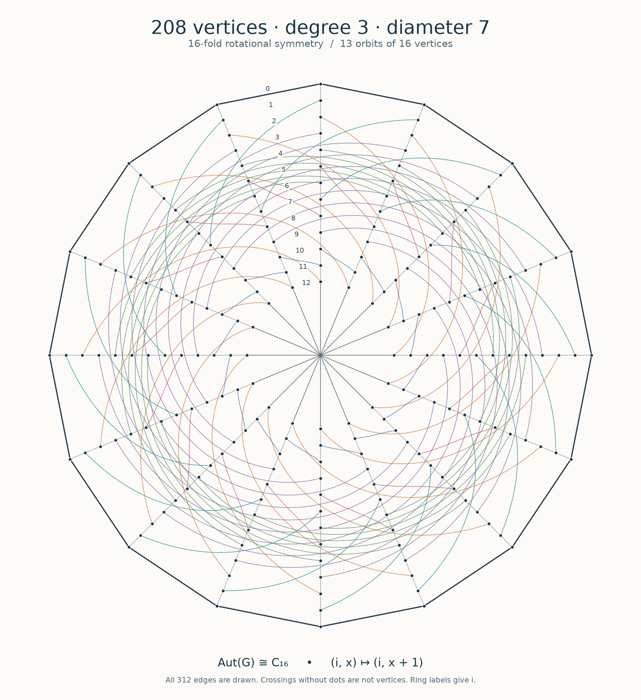
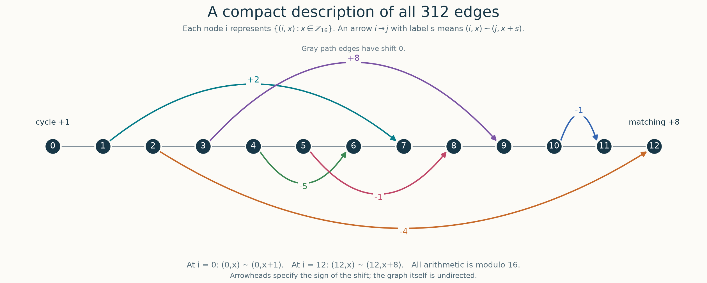

# Degree 3, diameter 7: 208 vertices

A simple cubic graph of order **208**, size **312**, diameter **exactly 7**,
and girth **9**. Thus $N(3,7)\ge208$.

Added to this repository on **2026-11-04** from the construction package dated
2026-09-26. The order exceeds the **200** in
[Comellas's table](https://web.mat.upc.edu/francesc.comellas/delta-d/table_degree_diameter.html)
as accessed on 2026-11-04 by **8 vertices (4%)**. It is not yet reflected in
that table. This comparison does not assert optimality.

## Construction and symmetry

Vertices are $(i,x)\in\{0,\ldots,12\}\times\mathbb Z_{16}$, numbered $16i+x$.
Join successive states at the same coordinate, add the cycle
$(0,x)\sim(0,x+1)$, the matching $(12,x)\sim(12,x+8)$, and the six
families $(i,x)\sim(j,x+s)$:

| $i$ | $j$ | $s\pmod{16}$ |
|---:|---:|---:|
| 1 | 7 | 2 |
| 2 | 12 | −4 |
| 3 | 9 | 8 |
| 4 | 6 | −5 |
| 5 | 8 | −1 |
| 10 | 11 | −1 |

The full automorphism group is $C_{16}$, acting by
$(i,x)\mapsto(i,x+c)$. There are 13 vertex orbits, each of size 16.
The graph is not vertex-transitive. The
[proof and finite certificates](certificate/proof.md) establish both the
diameter and the full automorphism group.

This is a cyclic voltage construction with a quotient having a loop and a
semiedge. It shares a fiber description with the constructions in
[arXiv:2606.15860](../diameter5-paper/), but is not a route-chart lift graph
as defined there: the fiber is $\mathbb Z_{16}$ and the edge maps are fixed
translations, without the paper's field parameter or universal route chart.

All 208 vertices and 312 edges are shown; crossings without dots are not
vertices. [SVG](figures/n37_208_rotation.svg) · [PDF](figures/n37_208_rotation.pdf)

[Quotient SVG](figures/n37_208_voltage.svg) · [Quotient PDF](figures/n37_208_voltage.pdf)

## Data and verification

- [Edge list](certificate/graph.edges): first line is the vertex count 208
  and edge count 312, then one undirected edge per line, with IDs 0–207.
- [Adjacency list](certificate/graph.adjlist): each row gives a vertex and
  all three neighbors.
- [Constructor](certificate/construct.py), [proof](certificate/proof.md),
  and [13 spanning trees](certificate/certificates/thirteen_trees.json).
- [Construction verification](../../verification/import-2026-11-04/degree3-diameter7-construction.json),
  [independent ordinary BFS](../../verification/independent-2026-11-04/degree3-diameter7.json),
  and [common C++ verification](../../verification/final/degree3-diameter7.json).
- [Exact source archive](certificate/archive/n37_208_construction_2026-09-26.zip)
  and [provenance](certificate/provenance.json). Its dated comparison values
  and unsuccessful search trials are historical material, not additional records.
- [SHA-256 manifest](SHA256SUMS).

From the repository root, using Python 3.10 or later:

    python3 results/degree3-diameter7/certificate/verify.py
    python3 results/degree3-diameter7/certificate/construct.py --out /tmp/ddp-208
    python3 verification/verify_small_graphs.py --output /tmp/ddp-small-checks

The first command checks the edge formula, adjacency list, modular reachability,
spanning trees, girth, and symmetry argument. The last command independently
checks both November additions by ordinary BFS from every vertex, without a
depth limit or construction data. The public edge list has the same vertex
labels and edges as the source package; only its header is standardized.

The [figure generator](figures/draw.py) additionally requires Matplotlib.
