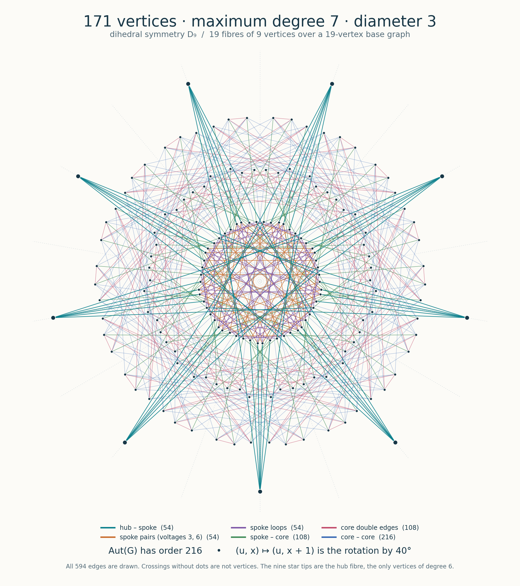
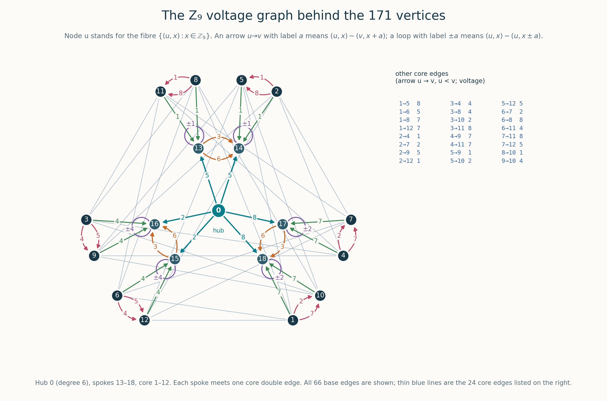

# Degree 7, diameter 3: 171 vertices

A simple graph of order **171**, size **594**, maximum degree **7**, and diameter **exactly 3**.
Thus $N(7,3)\ge171$. Nine vertices have degree 6; the other 162 have degree 7.

Added to this repository on **2026-11-10**. The order exceeds the **170** in
[Comellas's table](https://web.mat.upc.edu/francesc.comellas/delta-d/table_degree_diameter.html)
as accessed on 2026-11-10 (page last changed 2026-11-04) by **1 vertex**; the Moore bound is 302.
It is not yet reflected in that table. This comparison does not assert optimality.

## Construction

The graph is a regular $\mathbb Z_9$-cover of a 19-vertex base multigraph. Vertices are
$(u,x)$ with $u\in\{0,\ldots,18\}$ and $x\in\mathbb Z_9$, numbered $9u+x$. A base edge $u-v$
($u<v$) with voltage $a$ joins $(u,x)$ to $(v,x+a)$; a loop with voltage $a$ joins $(u,x)$ to
$(u,x\pm a)$.

The base graph has a hub $0$, six spokes $13,\ldots,18$ and twelve core vertices $1,\ldots,12$:

- hub edges $0-13,0-14$ (voltage 5), $0-15,0-16$ (voltage 2), $0-17,0-18$ (voltage 8);
- spoke pairs $13-14$, $15-16$, $17-18$, each a double edge with voltages $3,6$, and a loop at
  each spoke (voltage 1 at 13, 14; 4 at 15, 16; 2 at 17, 18);
- spoke–core edges $13-8,13-11,14-2,14-5$ (voltage 1), $15-6,15-12,16-3,16-9$ (voltage 4),
  $17-4,17-7,18-1,18-10$ (voltage 7);
- 36 core edges, containing the double edges $\{1,10\},\{2,5\},\{3,9\},\{4,7\},\{6,12\},\{8,11\}$;
  the complete voltage list is in [construct.py](certificate/construct.py).

The hub has base degree 6, so its fibre $\{(0,x)\}$ consists of the nine vertices of degree 6.

## Symmetry and origin

The translations by $\mathbb Z_9$ act freely. The full automorphism group, computed with nauty
and identified with GAP, has order **216** (SmallGroup(216,96) $=(C_2\times C_2)\rtimes(C_9\rtimes C_6)$),
with vertex orbits the hub fibre (9), the core fibres (108) and the spoke fibres (54).

The graph was found on 2026-11-10 by a systematic search over *orbit graphs* — unions of orbitals
of a finite group acting on a disjoint union of coset spaces — as the graph of SmallGroup(108,19)
on $G/A_4\sqcup G\sqcup G/C_2$ (9 + 108 + 54 points), a union of 7 orbitals. The search code is in
[search/orbit-graphs](../../search/orbit-graphs/).

All 171 vertices and 594 edges are shown; crossings without dots are not vertices. The rotation
by 40° is the translation $(u,x)\mapsto(u,x+1)$, and the mirror in the vertical axis is the
automorphism $(u,x)\mapsto(\sigma(u),m_u-x)$ recorded in [layout.json](figures/layout.json).
The nine star tips are the hub fibre. [SVG](figures/n73_171_symmetry.svg) · [PDF](figures/n73_171_symmetry.pdf)

[Base graph SVG](figures/n73_171_voltage.svg) · [Base graph PDF](figures/n73_171_voltage.pdf)

## Data and verification

- [Edge list](certificate/graph.edges): first line is the vertex count 171 and edge count 594,
  then one undirected edge per line, with IDs 0–170.
- [Adjacency list](certificate/graph.adjlist): each row gives a vertex and all its neighbors.
- [Constructor](certificate/construct.py), [voltage description](certificate/voltage_graph.json),
  [proof](certificate/proof.md), and [19 spanning trees](certificate/certificates/base_trees.json).
- [Orbit-graph certificate](certificate/orbit_graph_certificate.json) with an explicit isomorphism
  to the published labelling, and [automorphism generators](certificate/automorphisms.json).
- [Construction verification](../../verification/import-2026-11-10/degree7-diameter3-construction.json),
  [independent ordinary BFS](../../verification/independent-2026-11-10/degree7-diameter3.json),
  and [common C++ verification](../../verification/final/degree7-diameter3.json).
- [Provenance](certificate/provenance.json) and [SHA-256 manifest](SHA256SUMS).

From the repository root, using Python 3.10 or later (standard library only):

    python3 results/degree7-diameter3/certificate/verify.py
    python3 results/degree7-diameter3/certificate/construct.py --out /tmp/ddp-171
    python3 verification/verify_small_graphs.py --output /tmp/ddp-small-checks

The first command checks that the formula reproduces the published files, the 19 spanning trees,
the modular reachability of all 361 pairs of base vertices, the isomorphism with the orbit graph
found by the search, and the automorphism generators. The last command independently checks the
November additions by ordinary BFS from every vertex.

The [figure generator](figures/draw.py) additionally requires Matplotlib. It checks that the
drawing contains exactly the published edges, that both symmetries are automorphisms realised by
the coordinates, and that no edge passes close to a vertex it does not contain.
